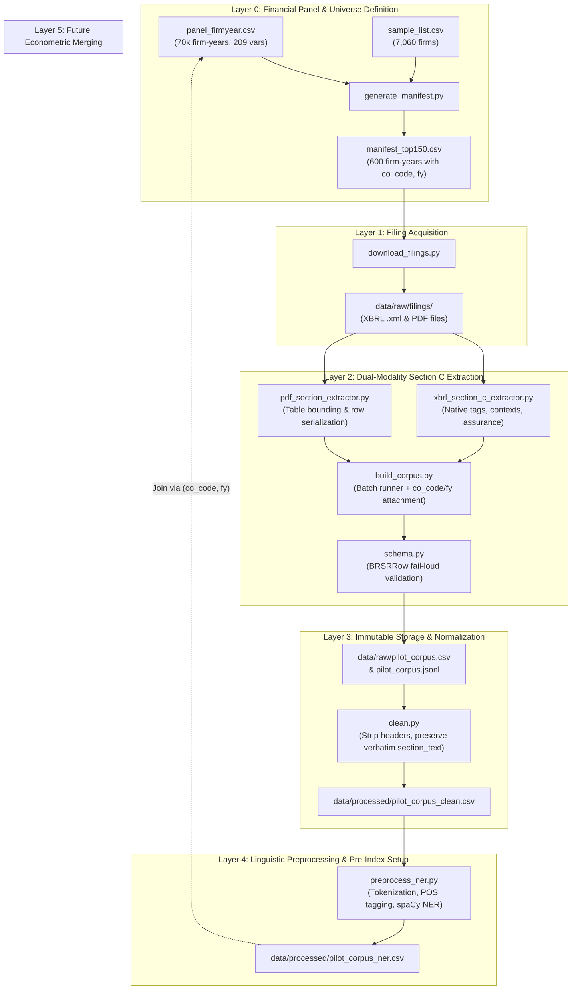

# BRSR Narrative Extraction, NLP Pipeline & Econometric Panel

A reproducible, high-fidelity computational linguistics extraction, natural language processing, and econometric analysis pipeline for SEBI Business Responsibility and Sustainability Reporting (BRSR) filings, linked to Prowess financial and corporate governance panel data.

---

## Project Objectives

1. **Corpus Construction:** Extract and partition unstructured narrative disclosures from SEBI BRSR Section C (Principles 1–9, Essential vs. Leadership indicators) across the **Top-150 listed firms for FY2022–23 through FY2025–26** (~600 firm-years $\approx$ 10,800 disclosure rows), extracting from **both native XBRL (`.xml`) and PDF** for every filing, so that error rates can be compared by source format.
2. **Computational Linguistics Quality Index:** Operationalize the four principles and tools of corporate disclosure analysis from El-Haj et al. (2019) to construct a 5-component disclosure quality index:
   - **Specificity & Concrete Claims:** Named entity and numerical claim density.
   - **Keyness & ESG Vocabulary:** Log-likelihood ($G^2$) against general reference corpora.
   - **Bog-Style Clarity:** Readability, syntactic complexity, and sentence clarity.
   - **Cross-Principle Balance:** Disclosure entropy across all 9 NGRBC principles.
   - **Assurance-Narrative Gap:** Divergence between third-party assured BRSR Core metrics and narrative claims.
3. **Econometric Validation:** Link text-based quality scores to the Prowess master panel on `(co_code, fy)` to empirically evaluate whether narrative disclosure quality reflects genuine ESG performance, superior governance, or corporate greenwashing.

---

## End-to-End Pipeline Architecture



---

## Directory & File Structure

```text
.
├── data/
│   ├── Panel/                    # Prowess master financial & governance datasets
│   │   ├── panel_firmyear.csv    # 70,343 firm-years x 209 variables (FY2020–FY2026)
│   │   ├── sample_list.csv       # 7,060 firms universe with ISIN, NSE/BSE codes, NIC
│   │   ├── data_dictionary.csv   # Data dictionary for all 209 panel variables
│   │   └── explore_panel.py      # Panel exploration & cohort integrity verification script
│   │
│   ├── raw/
│   │   ├── filings/              # Downloaded source filings (XBRL .xml and .pdf)
│   │   ├── pilot_corpus.csv      # Tabular raw corpus ledger with co_code and fy (full XBRL corpus, 9,980 rows)
│   │   ├── pilot_corpus.jsonl    # Immutable append-only JSONL ledger
│   │   └── _smoke_test.csv       # Schema smoke test verification sample
│   │
│   ├── processed/                # Normalized & NLP-enriched corpora
│   │   ├── pilot_corpus_clean.csv # Cleaned narratives with token and word counts
│   │   └── pilot_corpus_ner.csv   # Preprocessed corpus with sentence & entity distributions
│   │
│   └── qa/                       # Provenance logs, audit checklists, and spot-checks
│       ├── download_log.csv      # Filing download audit trail (created on first non-dry-run)
│       ├── qa_notes.md           # QA audit notes and discrepancy tracking
│       └── qa_verification_log.csv # Manual verification spot-check log
│
├── literature/                   # Academic foundation: El-Haj et al. (2019)
├── manifest_top150.csv           # Manifest of 600 firm-years for Top-150 cohort (FY23–FY26)
├── pilot_manifest.csv            # Initial 5-firm pilot manifest
├── panel_integration_plan.md     # Plan for merging the panel with the corpus
├── Structure.svg                 # Pipeline structure diagram
├── trash/                        # Discarded files, kept for reference
├── Plans and explanations/       # Planning notes and explanations
│
├── schema.py                     # Canonical 15-field BRSRRow dataclass with fail-loud validation
├── data_dictionary.md            # Formal documentation of the 15-field schema and NGRBC rules
├── QC_report.md                  # Prowess panel quality control audit report
│
├── generate_manifest.py          # Programmatic manifest builder for Top-150/250/500/1000 cohorts
├── download_filings.py           # Automated harvester & locator for BSE/NSE filings
├── pdf_section_extractor.py      # PDF locator, table bounding box detector, and row serializer
├── xbrl_section_c_extractor.py   # Native XBRL extractor (structured tags, contexts, assurance)
├── xbrl_inspect.py               # Diagnostic element and namespace inspector
├── build_corpus.py               # Batch extraction engine attaching panel keys (co_code, fy)
├── clean.py                      # Narrative cleaner (preserves immutable raw section_text)
├── preprocess_ner.py             # Linguistic preprocessor (sentence splitting, POS, spaCy NER)
├── requirements.txt              # Pipeline dependencies
└── README.md                     # Project documentation (this file)
```

---

## Current Status & Recent Updates

1. **Financial Panel Integration:**
   - Ingested Prowess master panel ([`data/Panel/panel_firmyear.csv`](file:///run/media/ssingh3/New%20Volume1/BITS/4-1/Project/Sukanya/data/Panel/panel_firmyear.csv), 70,343 rows $\times$ 209 columns) and firm master list ([`data/Panel/sample_list.csv`](file:///run/media/ssingh3/New%20Volume1/BITS/4-1/Project/Sukanya/data/Panel/sample_list.csv), 7,060 companies).
   - Validated that `top150_fyend == 1` yields **exactly 150 unique firms per fiscal year** across FY2022–23 (`fy=2023`), FY2023–24 (`fy=2024`), FY2024–25 (`fy=2025`), and FY2025–26 (`fy=2026`), totaling **600 firm-years** across 197 unique companies.
2. **Canonical Schema Upgrade (15 Fields):**
   - Updated [`schema.py`](file:///run/media/ssingh3/New%20Volume1/BITS/4-1/Project/Sukanya/schema.py) to incorporate `co_code` and `fy` into [`BRSRRow`](file:///run/media/ssingh3/New%20Volume1/BITS/4-1/Project/Sukanya/schema.py#L115).
   - Enforced bidirectional consistency between `fy` (year-end calendar year) and `fiscal_year` (string label e.g. `"FY2023-24"`).
   - Maintained backward compatibility (defaulting `co_code=0`, `fy=0` for legacy pilot rows).
3. **Automated Manifest & Harvester Layer:**
   - Created [`generate_manifest.py`](file:///run/media/ssingh3/New%20Volume1/BITS/4-1/Project/Sukanya/generate_manifest.py) to generate [`manifest_top150.csv`](file:///run/media/ssingh3/New%20Volume1/BITS/4-1/Project/Sukanya/manifest_top150.csv), mapping ISIN, BSE scrip code, NSE symbol, and local filing availability.
   - Built [`download_filings.py`](file:///run/media/ssingh3/New%20Volume1/BITS/4-1/Project/Sukanya/download_filings.py) with dry-run planning, browser session headers, file validation, and audit logging. It warns when manifest rows have no download URL, and it creates the audit log on each real run.
   - Filing coverage (7 Nov 2026): **581 of 600** firm-years have an XBRL `.xml` on disk (FY2023: 143, FY2024: 147, FY2025: 148, FY2026: 143). **19 are still `pending_download`** (not found on NSE; several are renames/mergers such as HDFC Ltd, Eternal/Zomato, Adani Energy Solutions). **No Top-150 PDFs have been collected**: the only PDFs on disk are the 5 pilot reports, so the XBRL-vs-PDF error comparison has no cohort PDFs yet.
4. **Extraction Engine Refinements:**
   - Updated [`xbrl_section_c_extractor.py`](file:///run/media/ssingh3/New%20Volume1/BITS/4-1/Project/Sukanya/xbrl_section_c_extractor.py) with regex pattern matching for SEBI BRSR taxonomy elements, resolving previously zero-count Leadership disclosures across Principles 1, 4, 7, and 9.
   - Updated [`build_corpus.py`](file:///run/media/ssingh3/New%20Volume1/BITS/4-1/Project/Sukanya/build_corpus.py) to accept dynamic manifests, stream records into CSV and JSONL, and preserve `(co_code, fy)` keys across both PDF and XBRL extractions.
5. **End-to-End Pipeline Verification:**
   - Full XBRL extraction (`build_corpus.py --manifest manifest_top150.csv --source xbrl`, 7 Nov 2026): **9,980 rows from 581 firm-years**, 100% non-zero `co_code`/`fy`, no duplicate `(co_code, fy, principle, indicator)` keys, no empty `section_text`; CSV and JSONL ledgers agree row for row.
   - Cleaned text through [`clean.py`](file:///run/media/ssingh3/New%20Volume1/BITS/4-1/Project/Sukanya/clean.py) and preprocessed through [`preprocess_ner.py`](file:///run/media/ssingh3/New%20Volume1/BITS/4-1/Project/Sukanya/preprocess_ner.py), verifying that all panel join keys persist intact. `clean.py` was re-run on the full ledger: 9,980 rows, 0 rows with altered `section_text`.
6. **Block coverage and known extraction gaps (not yet hand-verified):**
   - Only 323 of 581 firm-years have all 18 blocks (9 principles x Essential/Leadership); 189 have 17 and 69 have 16 or fewer, 27 of them 12 or fewer.
   - Missing blocks are almost all **Leadership** indicators (most often P7 Leadership, absent in 226 firm-years). Leadership disclosures are voluntary, so some absence is genuine, but it may also be an extractor pattern miss. Check before treating absence as non-disclosure in the balance index.
   - Some firms are short by the same amount every year (e.g. Power Grid: 12 blocks in every year FY2022-23 to FY2025-26; also Bajaj Holdings, MRF, SRF, Tata Consumer, Procter & Gamble Hygiene), which suggests a systematic extractor or filing-structure cause.
7. **Pilot data reconciliation:** the file names `pilot_corpus*.csv/jsonl` now hold the **full XBRL corpus** (the name is historical). The earlier 5-firm pilot outputs, including the only PDF-extracted rows (Infosys, TCS, Tech Mahindra, FY2024-25), are archived in `data/processed/legacy_pilot/` and are not part of the corpus. Note that `build_corpus.py` overwrites `data/raw/pilot_corpus.*` by default; pass `--output-csv/--output-jsonl` to avoid that.
8. **Dependencies:** `requirements.txt` now lists `requests`, `textstat`, `scikit-learn`, `statsmodels` and `linearmodels` as well. `build_panel.py` (cited in `QC_report.md`) is **not in this repository**, so the panel cannot be rebuilt from it; obtain it from the Prowess-side workflow.

---

## Step-by-Step Execution Guide

### 0. Setup
```bash
pip install -r requirements.txt
python -m spacy download en_core_web_sm
```

### 1. Panel Exploration & Integrity Verification
```bash
python data/Panel/explore_panel.py
```
Validates the Prowess panel, checks Top-150 cohort sizes for FY23–FY26, and calculates missingness on key financial/governance variables (`roa_w`, `tobins_q_w`, `board_size`, `promoter_pct`). Variables missing from the panel are reported as a warning.

### 2. Generate Study Cohort Manifest
```bash
# Generate manifest for Top-150 cohort across FY2023–FY2026 (600 firm-years):
python generate_manifest.py --cohort top150 --output manifest_top150.csv
```

### 3. Sourcing Filings via Automated NSE Scraper
The harvester automatically queries the official **NSE India BRSR Portal** (`https://www.nseindia.com/companies-listing/corporate-filings-bussiness-sustainabilitiy-reports`), resolves corporate symbols, bypasses Akamai WAF cookies, and streams structured `.xml` filings directly to `data/raw/filings/{isin}_{fy}.xml`:

```bash
# Preview pending downloads without network calls (dry run):
python scrape_nse_brsr.py --dry-run --fy 2024

# Download filings for a specific company:
python scrape_nse_brsr.py --symbol INFY --fy 2024

# Harvest a batch of Top-150 filings (e.g. first 10 for FY 2024):
python scrape_nse_brsr.py --fy 2024 --limit 10

# Harvest all Top-150 filings for FY 2024 (also downloads PDFs if --download-pdf is added):
python scrape_nse_brsr.py --fy 2024

# Alternatively, download_filings.py automatically delegates to the NSE harvester:
python download_filings.py --manifest manifest_top150.csv --fy 2024 --source xbrl --limit 10
```
Every downloaded file is validated for XML well-formedness with `xml.etree.ElementTree`, automatically marked as `xbrl_found: TRUE` and `status: ready` in `manifest_top150.csv`, and provenance is logged to `data/qa/download_log.csv`.

### 4. Batch Section C Extraction (Dual-Modality)
```bash
# XBRL only (what has been run so far; 581 filings, a few minutes):
python build_corpus.py --manifest manifest_top150.csv --source xbrl
# Both modalities (needs PDFs on disk for the firm-years; only the 5 pilot PDFs exist today):
python build_corpus.py --manifest manifest_top150.csv --source dual --table-mode serialized
# WARNING: output defaults to data/raw/pilot_corpus.* and is overwritten on every run.
```
Outputs:
- `data/raw/pilot_corpus.csv`: Standard raw tabular dataset carrying `(co_code, fy)`.
- `data/raw/pilot_corpus.jsonl`: Immutable append-only raw ledger preserving verbatim line breaks.

### 5. Clean Narrative Disclosures
```bash
python clean.py data/raw/pilot_corpus.csv data/processed/pilot_corpus_clean.csv
```
Strips recurring running headers, footers, and page numbers, preserves immutable `section_text`, and outputs normalized `cleaned_text` and `word_count`.

### 6. Linguistic Preprocessing & NER Baseline
```bash
python preprocess_ner.py data/processed/pilot_corpus_clean.csv data/processed/pilot_corpus_ner.csv
```
Computes sentence counts, token counts, and spaCy entity distributions (ORG, DATE, CARDINAL, LAW, MONEY, etc.) per principle-indicator block.

---

## Next Steps

1. **Filing Collection (Top-150):** Resolve the 19 missing XBRL firm-years (retry under former symbols; decide how to treat mergers), and agree a PDF sample scope for the XBRL-vs-PDF comparison. Confirm that automated retrieval from NSE/BSE and scripted Prowess extraction are permitted before any further bulk downloading.
2. **Hand-Check Parsing (5 Reports):** Perform visual spot-checks on 5 diverse reports (table bounding, Section C headers, Essential vs. Leadership splits) and document findings in `data/qa/qa_notes.md`.
3. **Gold-Standard Labelled Set (~50 Sections):** Sample 50 sections across principles and annotate for specificity vs. boilerplate once labelling guidelines are finalized.
4. **Compute 5 Index Components:** Implement specificity, keyness ($G^2$ against reference wordlist), Bog-style clarity score, cross-principle balance, and assurance-narrative gap.
5. **Econometric Analysis:** Merge quality scores with `panel_firmyear.csv` on `(co_code, fy)` to regress narrative quality against financial performance and corporate governance indicators.
