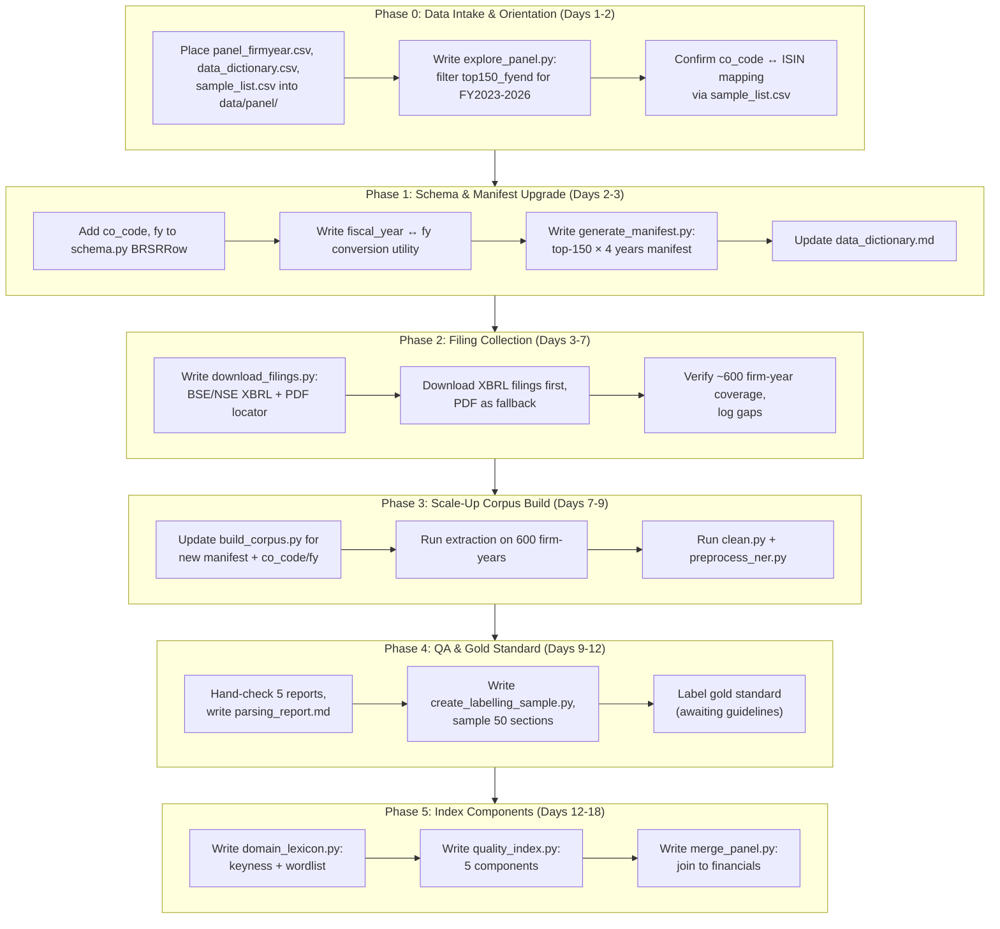

# Plan: Integrating the Panel Dataset and Scaling to Top-150 Firms

## Goal Description

Your advisor has shared three new files — `panel_firmyear.csv` (~70,000 firm-years, 209 columns), `data_dictionary.csv`, and `sample_list.csv` (7,060 companies) — that form the **financial and governance backbone** your text-based quality scores will ultimately be regressed against. This plan analyzes the gap between your current project state and the new requirements, identifies every code/schema/data change needed, and lays out the execution roadmap.

### Where You Are Now

| Dimension | Current State |
|---|---|
| **Corpus** | 5 pilot firms, 1 fiscal year (FY2024-25), 180 rows (90 PDF + 90 XBRL) |
| **Schema** | 13 fields in `BRSRRow`: keyed on `company_id` (ISIN) + `fiscal_year` (format `FY2024-25`) |
| **Panel join keys** | Missing `co_code` and `fy` — the panel's primary key pair |
| **Firm list** | Ad-hoc 5 firms in `pilot_manifest.csv` |
| **Financial data** | None |
| **Index components** | None computed yet |

### Where You Need To Be

| Dimension | Target State |
|---|---|
| **Corpus** | Top-150 firms × 4 fiscal years (FY2022-23 through FY2025-26) ≈ **600 firm-years × 18 rows = ~10,800 rows** |
| **Schema** | Must include `co_code` and `fy` in every row for direct `(co_code, fy)` join to the panel |
| **Firm list** | Derived from `sample_list.csv` filtered by `top150_count > 0`, then cross-referenced with panel cohort flags `top150_fyend` for FY2023–FY2026 |
| **Financial data** | `panel_firmyear.csv` merged via `(co_code, fy)` |
| **Index components** | Specificity, Keyness/Bog-clarity, Cross-principle balance, Assurance-narrative gap, Gold-standard labels |

---

## Requirements Breakdown

Your advisor's email contains **5 explicit next steps**. Here is each one decomposed into concrete technical work:

### Requirement 1: "Read the QC report and data dictionary, confirm you can filter to top 150 for FY2023–FY2026"

**What this means:**
- Place `panel_firmyear.csv`, `data_dictionary.csv`, and `sample_list.csv` into a sensible location in your project tree (e.g., `data/panel/`).
- Write a short exploratory script that:
  1. Loads `panel_firmyear.csv`.
  2. Filters using `top150_fyend == True` (or equivalent) for `fy` ∈ {2023, 2024, 2025, 2026}.
  3. Confirms the count, reports how many unique `co_code` values appear per year.
  4. Joins to `sample_list.csv` to get ISINs and company names.

**Code changes needed:** New script (`explore_panel.py` or notebook). No existing files change.

### Requirement 2: "Collect BRSR reports for top-150 firms for FY2022-23 to FY2025-26, build corpus with `co_code` and `fy`"

**What this means — this is the biggest piece:**

#### 2a. Schema changes to `schema.py`

Your current `BRSRRow` is keyed on `company_id` (ISIN) and `fiscal_year` (string like `FY2024-25`). The panel is keyed on `(co_code, fy)` where:
- `co_code` is a Prowess numeric company code
- `fy` is an integer (e.g., 2024 means FY2023-24)

You need to add **two new fields** to `BRSRRow`:

```python
@dataclass
class BRSRRow:
    company_id: str           # ISIN — keep this, it's your universal key
    company_name: str
    sector: str
    fiscal_year: str          # "FY2023-24" — keep for human readability
    co_code: int = 0          # ← NEW: Prowess company code for panel join
    fy: int = 0               # ← NEW: Calendar year of 31-Mar year-end (e.g., 2024)
    principle_number: int
    indicator_type: str
    section_text: str
    source_type: str
    source_url_or_filepath: str
    extraction_date: str
    extraction_method: str
    prowess_industry: str = ""
    nic_code: str = ""
```

> [!IMPORTANT]
> The `fy` convention: `fy = 2024` means FY2023-24 (the calendar year of the 31 March year-end). Your current `fiscal_year = "FY2024-25"` maps to `fy = 2025`. You need a utility function to convert between the two formats.

#### 2b. Manifest overhaul

Your `pilot_manifest.csv` currently has 5 rows with hardcoded paths. For 150 firms × 4 years = 600 firm-years, you need:
- A **manifest generator** script that takes `sample_list.csv` + `panel_firmyear.csv`, filters to the top-150 cohort, and produces a manifest with `co_code`, `fy`, ISIN, company name, and expected filing paths.
- A **filing downloader/locator** that checks BSE/NSE for XBRL filings and PDFs.

#### 2c. Build corpus at scale

`build_corpus.py` currently reads `pilot_manifest.csv` and processes 5 firms. It needs to:
- Accept the new expanded manifest.
- Populate `co_code` and `fy` in every emitted `BRSRRow`.
- Handle missing filings gracefully (some firms in FY2022-23 may not have filed BRSR yet — it only became mandatory for top-1000 from FY2022-23).

### Requirement 3: "Hand-check parsing on ~5 reports, send a short note"

**What this means:**
- Your existing `data/qa/` structure and `qa_verification_log.csv` are the right place for this.
- Expand the QA log to cover 5 diverse firms from the new top-150 set.
- Write a concise markdown report summarizing: what parsing issues you found, what you fixed, error rates.
- This is mostly manual work, but you should templatize the QA note.

**Code changes needed:** Template in `data/qa/parsing_report.md`. Possibly a small QA helper script.

### Requirement 4: "Label ~50 gold-standard report sections (specific vs. boilerplate)"

**What this means:**
- Create a **gold-standard labelling dataset**: ~50 randomly sampled `(company, year, principle, indicator)` text blocks.
- Each gets a human label: `specific` vs. `boilerplate` (and possibly a finer scale).
- This becomes the validation set for your specificity/boilerplate classifier.
- You need a labelling template and a script to sample the 50 sections.

**Code changes needed:**
- New script: `create_labelling_sample.py` — randomly samples 50 sections stratified by principle and indicator type.
- New file: `data/gold/labelling_template.csv` with columns like `company_id, co_code, fy, principle_number, indicator_type, section_text_preview, label_specific_boilerplate, annotator_notes`.
- Awaiting labelling guidelines from advisor before executing.

### Requirement 5: "Compute index components"

**What this means — the five components:**

| Component | Description | Dependencies |
|---|---|---|
| **Specificity** | Named entity density, concrete numerical claims per token | NER pipeline (already started in `preprocess_ner.py`) + domain gazetteer |
| **Keyness against BRSR wordlist** | Log-likelihood ($G^2$) of firm's vocabulary vs. a reference corpus | Full corpus built first, then `domain_lexicon.py` |
| **Bog-style clarity score** | Readability / plain English index (Fog Index, Flesch-Kincaid, sentence complexity) | Tokenization pipeline |
| **Cross-principle balance** | Variance/entropy of disclosure length and quality across P1–P9 | Full corpus with all 9 principles per firm-year |
| **Assurance-narrative gap** | Divergence between what's assured (XBRL assurance metadata) and what's narratively disclosed | XBRL assurance extraction (already done in `xbrl_section_c_extractor.py`) + narrative quality scores |

**Code changes needed:**
- New module: `quality_index.py` (already outlined in your `next_steps_plan.md` as Phase 3).
- New module: `domain_lexicon.py` for keyness and wordlist induction.
- Modifications to `preprocess_ner.py` to compute readability/clarity metrics.

---

## Gap Analysis: Current Code vs. Requirements

### Files That Need Modification

| File | What Changes | Why |
|---|---|---|
| [`schema.py`](file:///run/media/ssingh3/New%20Volume1/BITS/4-1/Project/Sukanya/schema.py) | Add `co_code: int` and `fy: int` fields to `BRSRRow`; add `fiscal_year_to_fy()` utility | Panel join key requirement |
| [`build_corpus.py`](file:///run/media/ssingh3/New%20Volume1/BITS/4-1/Project/Sukanya/build_corpus.py) | Accept new manifest format; populate `co_code`/`fy` in every row; scale to handle 600+ firm-years | Scale-up from 5 to 150 firms × 4 years |
| [`pilot_manifest.csv`](file:///run/media/ssingh3/New%20Volume1/BITS/4-1/Project/Sukanya/pilot_manifest.csv) | Either replace or supplement with a dynamically generated manifest for top-150 | Current manifest has only 5 firms |
| [`data_dictionary.md`](file:///run/media/ssingh3/New%20Volume1/BITS/4-1/Project/Sukanya/data_dictionary.md) | Add documentation for `co_code`, `fy`, and panel join semantics | Schema now has 15 fields, not 13 |
| [`clean.py`](file:///run/media/ssingh3/New%20Volume1/BITS/4-1/Project/Sukanya/clean.py) | Carry forward `co_code` and `fy` through the cleaning pipeline | New fields must not be dropped |
| [`preprocess_ner.py`](file:///run/media/ssingh3/New%20Volume1/BITS/4-1/Project/Sukanya/preprocess_ner.py) | Add readability/clarity metrics (Fog Index, Flesch-Kincaid); carry forward `co_code`/`fy` | Bog-style clarity score requirement |
| [`README.md`](file:///run/media/ssingh3/New%20Volume1/BITS/4-1/Project/Sukanya/README.md) | Update to reflect new data sources, panel integration, and expanded pipeline | Documentation accuracy |
| [`requirements.txt`](file:///run/media/ssingh3/New%20Volume1/BITS/4-1/Project/Sukanya/requirements.txt) | Add `textstat` (readability), `scikit-learn` (similarity), `statsmodels`/`linearmodels` (regressions) | New computational dependencies |

### New Files Needed

| File | Purpose |
|---|---|
| `data/panel/panel_firmyear.csv` | Advisor's 70K-row financial/governance panel (place here) |
| `data/panel/data_dictionary.csv` | Advisor's 209-column data dictionary (place here) |
| `data/panel/sample_list.csv` | Advisor's 7,060-company scope list (place here) |
| `explore_panel.py` | EDA script: load panel, filter top-150 by year, confirm joins work |
| `generate_manifest.py` | Reads `sample_list.csv` + `panel_firmyear.csv` → produces `manifest_top150.csv` |
| `download_filings.py` | Automated/semi-automated script to locate and download BRSR filings from BSE/NSE |
| `create_labelling_sample.py` | Stratified random sampler for gold-standard annotation (~50 sections) |
| `data/gold/labelling_template.csv` | Template for human annotation of specific vs. boilerplate |
| `data/gold/labelling_guidelines.md` | Annotation guidelines (awaiting from advisor) |
| `domain_lexicon.py` | Keyness analysis ($G^2$), n-gram mining, ESG wordlist induction |
| `quality_index.py` | Computes all 5 index components and aggregates them |
| `merge_panel.py` | Joins text corpus quality scores to `panel_firmyear.csv` via `(co_code, fy)` |
| `data/qa/parsing_report.md` | Short note on parsing issues found during hand-check |

### Files That Do NOT Need Changes

| File | Why |
|---|---|
| [`pdf_section_extractor.py`](file:///run/media/ssingh3/New%20Volume1/BITS/4-1/Project/Sukanya/pdf_section_extractor.py) | Extraction logic is modality-agnostic; works on any BRSR PDF |
| [`xbrl_section_c_extractor.py`](file:///run/media/ssingh3/New%20Volume1/BITS/4-1/Project/Sukanya/xbrl_section_c_extractor.py) | XBRL extraction logic is universal across firms; recently fixed leadership patterns |
| [`xbrl_inspect.py`](file:///run/media/ssingh3/New%20Volume1/BITS/4-1/Project/Sukanya/xbrl_inspect.py) | Debugging utility; no change needed |

---

## Execution Roadmap



---

## Understanding the Panel Data

> [!NOTE]
> **Key concepts from the advisor's email you must internalize:**

### The `(co_code, fy)` Primary Key
- `co_code`: A Prowess-internal integer company identifier. Different from ISIN.
- `fy`: The calendar year of the March 31 year-end. So `fy = 2024` = FY2023-24. Your current `fiscal_year = "FY2024-25"` = `fy = 2025`.
- Your `sample_list.csv` should contain the mapping from `co_code` → ISIN. You **must** verify this.

### Cohort Filtering
- `top150_fyend`, `top250_fyend`, `top500_fyend`, `top1000_fyend` are Boolean columns in the panel indicating whether a firm was in that market-cap tier at financial year-end.
- Start with `top150_fyend == True` for `fy ∈ {2023, 2024, 2025, 2026}`.
- FY2026 data is provisional (partial filings).

### Winsorised Variables
- Use columns ending in `_w` for any regression (outlier-trimmed).
- Do **not** use `rank_total_income_in_data` for size — use `mcap_rank`.

### Financial Basis
- `fin_basis` indicates whether financials are consolidated or standalone.
- CSR figures always use `sa_csr_*` (standalone).

### Known Gaps
- No director gender data.
- No borrowings for consolidated filers.

---

## Open Questions

> [!IMPORTANT]
> **Questions to resolve before execution:**

1. **Have you received the three CSV files yet?** (`panel_firmyear.csv`, `data_dictionary.csv`, `sample_list.csv`). They are not currently in your project directory. You need to place them in `data/panel/` before any work begins.

2. **ISIN ↔ co_code mapping:** Does `sample_list.csv` contain both ISIN and `co_code`? If not, you'll need a separate crosswalk table from Prowess.

3. **Filing access method:** How will you download ~600 BRSR filings? Options:
   - Manual download from BSE India / NSE India filing portals
   - Automated scraping (requires understanding the BSE/NSE URL structure)
   - Prowess database export (if your institution has Prowess/CMIE access)

4. **FY2022-23 coverage:** BRSR was mandatory for top-1000 from FY2022-23 onwards, but some firms may have incomplete filings. Should you include FY2022-23 or start from FY2023-24?

5. **Labelling guidelines:** Your advisor says "I will send you the labelling guidelines" for the gold-standard set. The `create_labelling_sample.py` can be built now, but actual labelling is blocked until those guidelines arrive.

6. **XBRL priority vs. PDF:** Your current pipeline supports both. For the top-150 scale-up, should XBRL always be the primary source with PDF as fallback only, or should you extract both for cross-validation as you do now with `--source dual`?

---

## Verification Plan

### Phase 0 Verification
```bash
python explore_panel.py
# Should print: number of unique co_codes per year in top-150, confirm ISIN join
```

### Phase 1 Verification
```bash
python schema.py  # Smoke test with new co_code/fy fields
```

### Phase 3 Verification
```bash
# After full extraction:
python -c "
import csv
with open('data/raw/corpus.csv') as f:
    rows = list(csv.DictReader(f))
assert all(r['co_code'] for r in rows), 'Missing co_code'
assert all(r['fy'] for r in rows), 'Missing fy'
print(f'Rows: {len(rows)}, Unique firms: {len(set(r[\"co_code\"] for r in rows))}')
"
```

### Phase 5 Verification
```bash
python merge_panel.py  # Should confirm join rate > 95% on (co_code, fy)
```

### Manual Verification
- Open 5 extracted reports side-by-side with source PDFs/XMLs
- Verify that `co_code` and `fy` are correct for each
- Check that Section C boundaries and Essential/Leadership splits are accurate
