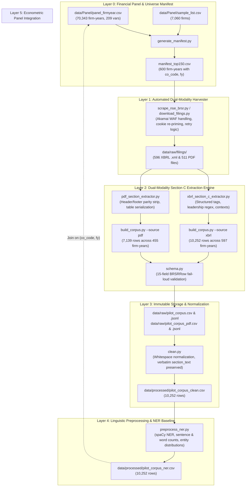

# SEBI BRSR Narrative Extraction, NLP Pipeline & Econometric Panel

[](https://www.python.org/)
[]()
[-blueviolet.svg)]()
[]()
[]()
[-purple.svg)]()

A reproducible, high-fidelity computational linguistics extraction, natural language processing (NLP), and econometric analysis pipeline for **SEBI Business Responsibility and Sustainability Reporting (BRSR)** filings, integrated with **CMIE Prowess** financial and corporate governance panel data.

---

## 1. Objectives

The Securities and Exchange Board of India (SEBI) mandates BRSR disclosures for listed entities across the nine **National Guidelines on Responsible Business Conduct (NGRBC)** principles. This project constructs an end-to-end empirical research pipeline to extract, evaluate, and econometrically validate corporate sustainability narratives.

### Core Research & Engineering Objectives
1. **Corpus Construction:** Extract and partition unstructured narrative disclosures from **Section C** (Principles 1–9, Essential vs. Leadership indicators) across the **Top-150 listed firms for FY2022–23 through FY2025–26** (600 firm-years, ~10,800 disclosure units).
2. **Dual-Modality Extraction Benchmarking:** Extract disclosures in parallel from **native XBRL (`.xml`)** and **annual report PDFs** to systematically quantify parser fidelity, reading-order accuracy, and table serialization error rates across reporting formats.
3. **Computational Linguistics Quality Index:** Operationalize the four principles of corporate disclosure analysis from [El-Haj et al. (2019)](literature/Business%20Fin%20%20%20Account%20-%202019%20-%20El%E2%80%90Haj%20-%20In%20search%20of%20meaning%20%20Lessons%20%20resources%20and%20next%20steps%20for%20computational%20analysis.pdf) into a 5-component disclosure quality index:
   - **Specificity & Concrete Claims:** Density of named entities (`ORG`, `MONEY`, `DATE`, `LAW`) and numerical assertions.
   - **Keyness & ESG Vocabulary:** Log-likelihood ($G^2$) against general reference corpora and ESG-specific vocabularies.
   - **Clarity & Readability:** Syntactic complexity, Flesch-Kincaid Grade Level, and Gunning Fog clarity indices.
   - **Cross-Principle Balance:** Shannon information entropy across all nine NGRBC principles.
   - **Assurance-Narrative Gap:** Divergence between third-party assured BRSR Core quantitative metrics and qualitative narrative claims.
4. **Econometric Validation:** Link text-derived linguistic quality scores to the CMIE Prowess master financial/governance panel via `(co_code, fy)` to empirically test whether corporate disclosure quality reflects substantive ESG performance, superior governance, or strategic greenwashing.

### Latest Progress & Empirical Coverage

| Pipeline Stage | Target Cohort | Harvested / Processed | Coverage (%) | Output Ledger / Artifacts |
|---|---|---|:---:|---|
| **Study Universe Manifest** | 150 firms $\times$ 4 FYs (FY23–FY26) | **600 firm-years** (197 unique firms) | **100.0%** | [`manifest_top150.csv`](manifest_top150.csv) |
| **XBRL Filings Harvester** | 600 firm-years | **596 firm-years** (603 `.xml` files on disk) | **99.3%** | `data/raw/filings/*.xml`, `data/qa/download_log.csv` |
| **PDF Filings Harvester** | 600 firm-years | **511 firm-years** (516 `.pdf` files on disk) | **85.2%** | `data/raw/filings/*.pdf`, `data/qa/download_log.csv` |
| **XBRL Section C Corpus** | 600 firm-years | **10,252 rows** (597 firm-years, 194 firms) | **99.5%** | `data/raw/pilot_corpus.csv` & `.jsonl` |
| **PDF Section C Corpus** | 511 PDF filings | **7,139 rows** (455 firm-years, 179 firms) | **89.0%** | `data/raw/pilot_corpus_pdf.csv` & `.jsonl` |
| **Cleaned Narrative Corpus** | Full XBRL Corpus | **10,252 rows** (Zero text loss, normalized) | **100.0%** | `data/processed/pilot_corpus_clean.csv` |
| **Linguistic / NER Corpus** | Full Cleaned Corpus | **10,252 rows** (spaCy tokenization & NER) | **100.0%** | `data/processed/pilot_corpus_ner.csv` |
| **CMIE Prowess Master Panel** | 70,343 firm-years, 209 vars | Ingested & cross-walked on `(co_code, fy)` | **100.0%** | `data/Panel/panel_firmyear.csv`, [`QC_report.md`](QC_report.md) |

---

## 2. Technologies

The project is built on Python 3.10+ using modular, high-performance libraries across data sourcing, document parsing, natural language processing, and econometrics:

- **Runtime & Core Environment:** Python 3.10+, virtual environments, POSIX compliance.
- **Automated Sourcing & Network Resilience:**
  - `requests`: HTTP client with automated cookie re-priming every 40 downloads to bypass Akamai WAF protections on the NSE India portal.
  - Provenance auditing: Deterministic status tracking (`success`, `http_error`, `download_error`, `not_found_on_nse`) logged to CSV.
- **Multi-Modal Document Parsing:**
  - **XBRL / XML:** `xml.etree.ElementTree`, `lxml`, `BeautifulSoup4` with regex-based SEBI BRSR taxonomy resolution for Leadership and Essential indicators across all contexts.
  - **PDF Extraction:** `pdfplumber`, `pypdf` with two-column reading order reconstruction, running header/footer parity stripping, and serialized table extraction.
- **Natural Language Processing & Computational Linguistics:**
  - `spaCy` (`en_core_web_sm`): Rule-based and statistical tokenization, sentence segmentation, POS tagging, and Named Entity Recognition (`ORG`, `DATE`, `MONEY`, `LAW`, `CARDINAL`).
  - `textstat`: Computational readability metrics including Flesch-Kincaid Grade Level and Gunning Fog Index.
  - `scikit-learn` & `scipy`: Vocabulary keyness calculations ($G^2$ log-likelihood), TF-IDF vectorization, cosine similarity, and Shannon entropy computation.
- **Data Engineering & Schema Integrity:**
  - `dataclasses`: Strict 15-field `BRSRRow` schema with fail-loud validation (enforces bidirectional `fy` $\leftrightarrow$ `fiscal_year` consistency and prevents silent schema drift).
  - `pandas`, `numpy`: High-throughput vectorized data processing, cleaning, and transformation.
  - Dual storage: UTF-8 CSV tabular representations and append-only `.jsonl` ledgers to preserve verbatim formatting.
- **Econometric Modeling & Statistics:**
  - `statsmodels`, `linearmodels`: Panel regression analysis (firm and year fixed effects, random effects, clustered standard errors) linking linguistic indices to financial performance and governance metrics from CMIE Prowess.

---

## 3. Architecture

The architecture is organized into six sequential layers ensuring end-to-end reproducibility, verbatim text immutability, and deterministic joins across NLP and econometric panels.



### Architectural Principles
- **Verbatim Text Immutability:** Raw extracted disclosures (`section_text`) are stored in immutable raw ledgers (`.jsonl` and `.csv`). All downstream cleaning is non-destructive and isolated to separate transformed columns (`cleaned_text`).
- **Fail-Loud Schema Enforcement:** Every extracted record is validated against [`schema.py`](schema.py) before writing. Records with missing identifiers, invalid NGRBC principles (1–9), or discordant `(fy, fiscal_year)` pairs abort execution immediately.
- **Cross-Modality Benchmarkability:** Identical 15-field schemas are used for both XBRL and PDF pipelines, allowing direct comparison of parser fidelity and table resolution across modalities.
- **Deterministic Econometric Keying:** Every record maintains `co_code` (Prowess company code) and `fy` (fiscal year end integer) to ensure lossless joining with CMIE Prowess financial and governance variables.

---

## 4. Usage Pipeline

### Setup & Environment
```bash
# Clone repository and create virtual environment
git clone https://github.com/ShahilSingh3/brsr-nlp-econometric-panel.git
cd brsr-nlp-econometric-panel
python3 -m venv .venv
source .venv/bin/activate

# Install dependencies and download language model
pip install -r requirements.txt
python -m spacy download en_core_web_sm
```

### Step 1: Universe Manifest Generation
Construct the study manifest linking ISINs, BSE scrip codes, NSE symbols, and Prowess identifiers:
```bash
# Generate manifest for the Top-150 cohort across FY2023–FY2026 (600 firm-years):
python generate_manifest.py --cohort top150 --output manifest_top150.csv
```

### Step 2: Automated Filing Acquisition
Download XBRL and PDF filings directly from the NSE portal with WAF session handling:
```bash
# Preview pending downloads without network requests (dry run):
python scrape_nse_brsr.py --dry-run --fy 2024

# Harvest all XBRL and PDF filings across FY2023–FY2026:
python scrape_nse_brsr.py --fy "2023,2024,2025,2026" --download-pdf

# Re-attempt only filings that encountered temporary network/HTTP errors:
python scrape_nse_brsr.py --retry-failed --download-pdf
```

### Step 3: Dual-Modality Section C Extraction
Extract narrative disclosures into structured row ledgers conforming to `BRSRRow`:
```bash
# 1. Native XBRL extraction across the Top-150 cohort:
# Produces data/raw/pilot_corpus.csv & pilot_corpus.jsonl (10,252 rows)
python build_corpus.py --manifest manifest_top150.csv --source xbrl

# 2. PDF extraction with reading-order recovery and table serialization:
# Produces data/raw/pilot_corpus_pdf.csv & pilot_corpus_pdf.jsonl (7,139 rows)
python build_corpus.py --manifest manifest_top150.csv --source pdf --table-mode serialized
```

### Step 4: Narrative Normalization & Cleaning
Normalize whitespace, remove recurring boilerplate headers, footers, and page numbers while preserving verbatim `section_text`:
```bash
python clean.py data/raw/pilot_corpus.csv data/processed/pilot_corpus_clean.csv
```

### Step 5: Linguistic Preprocessing & NER Baseline
Tokenize text, compute sentence and word counts, and calculate named entity distributions (`ORG`, `DATE`, `CARDINAL`, `MONEY`, `LAW`):
```bash
python preprocess_ner.py data/processed/pilot_corpus_clean.csv data/processed/pilot_corpus_ner.csv
```

### Step 6: Econometric Panel Integration & Exploration
Explore panel integrity, variable distributions, and join readiness with CMIE Prowess data:
```bash
python data/Panel/explore_panel.py
```
*(For complete panel variable definitions and audit methodology, see [`QC_report.md`](QC_report.md) and [`data_dictionary.md`](data_dictionary.md).)*
