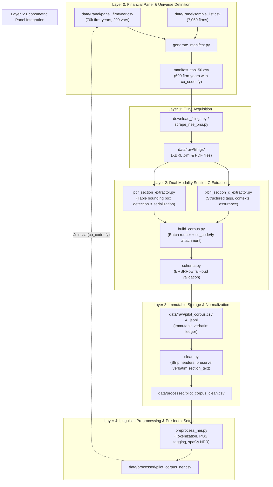

# SEBI BRSR Narrative Extraction, NLP Pipeline & Econometric Panel

[](https://www.python.org/)
[]()
[]()
[-purple.svg)]()

A reproducible, high-fidelity computational linguistics extraction, natural language processing (NLP), and econometric analysis pipeline for **SEBI Business Responsibility and Sustainability Reporting (BRSR)** filings, integrated with **CMIE Prowess** financial and corporate governance panel data.

---

## Table of Contents
- [Project Overview](#project-overview)
- [Pipeline Architecture](#pipeline-architecture)
- [Repository Structure](#repository-structure)
- [Canonical Data Schema](#canonical-data-schema)
- [Installation & Setup](#installation--setup)
- [Pipeline Execution Guide](#pipeline-execution-guide)
  - [1. Universe Manifest Generation](#1-universe-manifest-generation)
  - [2. Automated Sourcing via NSE Harvester](#2-automated-sourcing-via-nse-harvester)
  - [3. Dual-Modality Section C Extraction](#3-dual-modality-section-c-extraction)
  - [4. Narrative Normalization & Cleaning](#4-narrative-normalization--cleaning)
  - [5. Linguistic Preprocessing & NER Baseline](#5-linguistic-preprocessing--ner-baseline)
  - [6. Panel Exploration & Econometric Validation](#6-panel-exploration--econometric-validation)
- [Quality Control & Data Integrity](#quality-control--data-integrity)
- [Research Foundations & References](#research-foundations--references)

---

## Project Overview

In 2021, the Securities and Exchange Board of India (SEBI) mandated BRSR reporting for the top 1,000 listed entities, requiring structured non-financial disclosures across the nine **National Guidelines on Responsible Business Conduct (NGRBC)** principles.

This repository builds an end-to-end reproducible research pipeline to:
1. **Corpus Construction:** Extract and partition unstructured narrative disclosures from **Section C** (Principles 1–9, Essential vs. Leadership indicators) across the **Top-150 listed firms for FY2022–23 through FY2025–26** (~600 firm-years $\approx$ 10,800 disclosure units).
2. **Dual-Modality Extraction:** Extract narratives from **native XBRL (`.xml`)** and **annual report PDFs** to benchmark extraction fidelity and compare parser error rates across formats.
3. **Computational Linguistics Quality Index:** Operationalize the four principles of corporate disclosure analysis from [El-Haj et al. (2019)](literature/Business%20Fin%20%20%20Account%20-%202019%20-%20El%E2%80%90Haj%20-%20In%20search%20of%20meaning%20%20Lessons%20%20resources%20and%20next%20steps%20for%20computational%20analysis.pdf) into a 5-component disclosure quality index:
   - **Specificity & Concrete Claims:** Density of named entities (ORG, MONEY, DATE) and numerical assertions.
   - **Keyness & ESG Vocabulary:** Log-likelihood ($G^2$) against general reference corpora.
   - **Clarity & Readability:** Syntactic complexity, Flesch-Kincaid, and Gunning Fog clarity indices.
   - **Cross-Principle Balance:** Information entropy across all 9 NGRBC principles.
   - **Assurance-Narrative Gap:** Divergence between third-party assured BRSR Core quantitative metrics and narrative disclosures.
4. **Econometric Validation:** Link text-based linguistic quality scores to the CMIE Prowess master financial/governance panel on `(co_code, fy)` to test whether disclosure quality reflects substantive ESG performance, superior governance, or corporate greenwashing.

---

## Pipeline Architecture



---

## Repository Structure

```text
.
├── schema.py                     # Canonical 15-field BRSRRow dataclass with fail-loud validation
├── data_dictionary.md            # Formal documentation of schema fields, data types & NGRBC rules
├── QC_report.md                  # Comprehensive Prowess panel quality control audit report
├── requirements.txt              # Pipeline dependencies (requests, spacy, pandas, textstat, etc.)
│
├── generate_manifest.py          # Builds study cohort manifests (Top-150 / 250 / 500 / 1000)
├── download_filings.py           # Automated filing locator and harvester
├── scrape_nse_brsr.py            # NSE India BRSR portal scraper (handles sessions, WAF & XMLs)
├── pdf_section_extractor.py      # PDF locator, table bounding box detector, and row serializer
├── xbrl_section_c_extractor.py   # Native XBRL extractor (structured tags, contexts, assurance)
├── xbrl_inspect.py               # Diagnostic element and XML namespace inspector
├── build_corpus.py               # Batch extraction engine attaching panel keys (co_code, fy)
├── clean.py                      # Narrative cleaner (preserves immutable raw section_text)
├── preprocess_ner.py             # Linguistic preprocessor (sentence splitting, POS, spaCy NER)
│
├── manifest_top150.csv           # Manifest of 600 firm-years for Top-150 cohort (FY23–FY26)
├── pilot_manifest.csv            # Initial 5-firm pilot validation manifest
├── literature/                   # Academic foundation: El-Haj et al. (2019) reference paper
├── Plans and explanations/       # Detailed architecture notes and panel integration plans
│   ├── panel_integration_plan.md
│   └── README.md
│
├── data/                         # [Ignored in Git via .gitignore] Local runtime data directory:
│   ├── Panel/                    # Prowess financial & governance data (panel_firmyear.csv, sample_list.csv)
│   │   └── explore_panel.py      # Panel exploration & cohort integrity verification script
│   ├── raw/                      # Downloaded source filings (.xml, .pdf) & raw corpus ledgers
│   ├── processed/                # Cleaned narratives & NER-annotated corpora
│   └── qa/                       # Download logs, audit checklists, and verification notes
│
└── .gitignore                    # Excludes heavy raw/processed data while preserving code and manifests
```

---

## Canonical Data Schema

Every record in the extraction and analysis pipeline strictly conforms to the 15-field `BRSRRow` schema defined in [`schema.py`](schema.py) and documented in [`data_dictionary.md`](data_dictionary.md):

| # | Field Name | Data Type | Nullable | Example / Allowed Values | Description & Integrity Rules |
|---|------------|:---------:|:--------:|--------------------------|-------------------------------|
| 1 | `company_id` | `str` | **No** | `INE009A01021` | 12-char ISIN; primary security identifier across databases |
| 2 | `company_name` | `str` | **No** | `Infosys Limited` | Official registered legal corporate name |
| 3 | `sector` | `str` | **No** | `IT - Software` | Broad sector / industry classification |
| 4 | `fiscal_year` | `str` | **No** | `FY2023-24` | Fiscal reporting period |
| 5 | `principle_number` | `int` | **No** | `1` to `9` | NGRBC Principle index ($P_1$ through $P_9$) |
| 6 | `indicator_type` | `str` | **No** | `"Essential"`, `"Leadership"` | SEBI disclosure tier (Essential = mandatory, Leadership = voluntary) |
| 7 | `section_text` | `str` | **No** | Verbatim text | Raw, uncleaned narrative directly from filing. **Immutable once extracted.** |
| 8 | `source_type` | `str` | **No** | `"XBRL"`, `"PDF"` | Source document modality |
| 9 | `source_url_or_filepath` | `str` | **No** | `data/raw/filings/...` | Audit trail linking back to local file or filing URL |
| 10 | `extraction_date` | `str` | **No** | `2026-11-07` | ISO 8601 date of extraction execution |
| 11 | `extraction_method` | `str` | **No** | `"automated"`, `"manual-checked"` | Extraction provenance indicator |
| 12 | `prowess_industry` | `str` | Yes | `Information technology` | Granular industry classification from Prowess |
| 13 | `nic_code` | `str` | Yes | `62011` | 5-digit National Industrial Classification code |
| 14 | `co_code` | `int` | Yes | `100632` | Prowess company code; primary join key for financial panel |
| 15 | `fy` | `int` | Yes | `2024` | Year-end calendar year matching `panel_firmyear.csv` (`2024` = FY2023-24) |

> [!IMPORTANT]
> **Immutability Invariant:** The raw extracted narrative (`section_text`) is strictly immutable. Downstream cleaning or normalization is performed non-destructively, writing to separate columns (`cleaned_text`) and processed files (`data/processed/pilot_corpus_clean.csv`).

---

## Installation & Setup

### Prerequisites
- Python 3.10 or higher
- Git

### 1. Clone & Create Environment
```bash
git clone https://github.com/ShahilSingh3/brsr-nlp-econometric-panel.git
cd brsr-nlp-econometric-panel

# Create and activate virtual environment
python3 -m venv .venv
source .venv/bin/activate
```

### 2. Install Dependencies
```bash
pip install -r requirements.txt
python -m spacy download en_core_web_sm
```

---

## Pipeline Execution Guide

### 1. Universe Manifest Generation
Generate study cohort manifests with cross-walked ISINs, BSE codes, NSE symbols, and Prowess IDs:

```bash
# Generate manifest for the Top-150 cohort across FY2023–FY2026 (600 firm-years):
python generate_manifest.py --cohort top150 --output manifest_top150.csv
```

### 2. Automated Sourcing via NSE Harvester
The NSE harvester bypasses WAF session tokens, locates Section C XBRL filings, validates XML integrity, and logs download provenance:

```bash
# Preview pending downloads without network requests (dry run):
python scrape_nse_brsr.py --dry-run --fy 2024

# Download filings for an individual firm:
python scrape_nse_brsr.py --symbol INFY --fy 2024

# Harvest a batch of Top-150 filings (e.g. first 10 for FY 2024):
python scrape_nse_brsr.py --fy 2024 --limit 10

# Download all available filings for a specific fiscal year:
python scrape_nse_brsr.py --fy 2024

# Or orchestrate downloads via download_filings.py:
python download_filings.py --manifest manifest_top150.csv --fy 2024 --source xbrl
```

### 3. Dual-Modality Section C Extraction
Extract narrative disclosures into structured row ledgers:

```bash
# Native XBRL extraction across the Top-150 manifest:
python build_corpus.py --manifest manifest_top150.csv --source xbrl

# Dual-modality extraction (XBRL + PDF with serialized table structures):
python build_corpus.py --manifest manifest_top150.csv --source dual --table-mode serialized
```
Outputs are written to:
- `data/raw/pilot_corpus.csv`: Primary raw tabular ledger with `(co_code, fy)`.
- `data/raw/pilot_corpus.jsonl`: Append-only raw JSONL ledger preserving verbatim line breaks.

### 4. Narrative Normalization & Cleaning
Normalize whitespace, remove recurring boilerplate headers, footers, and page numbers while strictly preserving verbatim `section_text`:

```bash
python clean.py data/raw/pilot_corpus.csv data/processed/pilot_corpus_clean.csv
```

### 5. Linguistic Preprocessing & NER Baseline
Tokenize text, compute sentence and word counts, and calculate named entity distributions (ORG, DATE, CARDINAL, MONEY, LAW) using spaCy:

```bash
python preprocess_ner.py data/processed/pilot_corpus_clean.csv data/processed/pilot_corpus_ner.csv
```

### 6. Panel Exploration & Econometric Validation
Validate panel structure, check missingness, and verify cohort distributions:

```bash
python data/Panel/explore_panel.py
```
For an in-depth audit of Prowess panel variables, balance sheet identities, and sample coverage, see [`QC_report.md`](QC_report.md).

---

## Quality Control & Data Integrity

- **Fail-Loud Validation:** Enforced by [`schema.py`](schema.py) upon record creation. Any missing required fields, illegal values, or non-matching fiscal year pairs abort immediately.
- **Audit Trails:** Provenance and HTTP status codes for every filing download are tracked in `data/qa/download_log.csv`.
- **Spot-Check Audits:** Verified through manual inspection logged in `data/qa/qa_notes.md` and `data/qa/qa_verification_log.csv`.

---

## Research Foundations & References

- **El-Haj, M., Rayson, P., Walker, M., Young, S., & Simaki, V. (2019).** *In search of meaning: Lessons, resources and next steps for computational analysis of financial discourse.* Journal of Business Finance & Accounting, 46(3-4), 265–306. [`literature/Business Fin...El-Haj.pdf`](literature/Business%20Fin%20%20%20Account%20-%202019%20-%20El%E2%80%90Haj%20-%20In%20search%20of%20meaning%20%20Lessons%20%20resources%20and%20next%20steps%20for%20computational%20analysis.pdf)
- **Securities and Exchange Board of India (SEBI).** *Circular on Business Responsibility and Sustainability Reporting (BRSR)* (SEBI/HO/CFD/CMD-2/P/CIR/2021/562, May 10, 2021).
- **Ministry of Corporate Affairs (MCA), Government of India.** *National Guidelines on Responsible Business Conduct (NGRBC), 2019*.
